<div align="center">

<a href="https://entx.space">
  <picture>
    <source media="(prefers-color-scheme: dark)" srcset="docs/assets/wordmark-light.svg">
    
  </picture>
</a>

### Entertainment, now tradable.

A multichain entertainment exchange. Movies and TV shows become markets priced by one live score,<br>
the **Entertainment Popularity Index (EPI)**, with a NEAR contract for the registry, oracle, receipts and prediction pools.

[](#quick-start)
[](https://demo.entx.space)
[](https://testnet.nearblocks.io/address/entx-market-1794654167.testnet)
[](https://solana.entx.space)
[](LICENSE)

[](https://nextjs.org)
[](https://react.dev)
[](https://www.typescriptlang.org)
[](contracts/near/src/lib.rs)
[](https://bun.sh)
[](#hackathon)

**[Try the demo](https://demo.entx.space)** · **[Live site](https://entx.space)** · **[Solana build](https://solana.entx.space)** · **[Contract on NearBlocks](https://testnet.nearblocks.io/address/entx-market-1794654167.testnet)**<br>
▶ **[Launch video (20 s)](docs/assets/video/entx-launch.mp4)** · **[Testnet walkthrough (3:25)](docs/assets/video/testnet-walkthrough.mp4)**

<br>

<a href="https://demo.entx.space">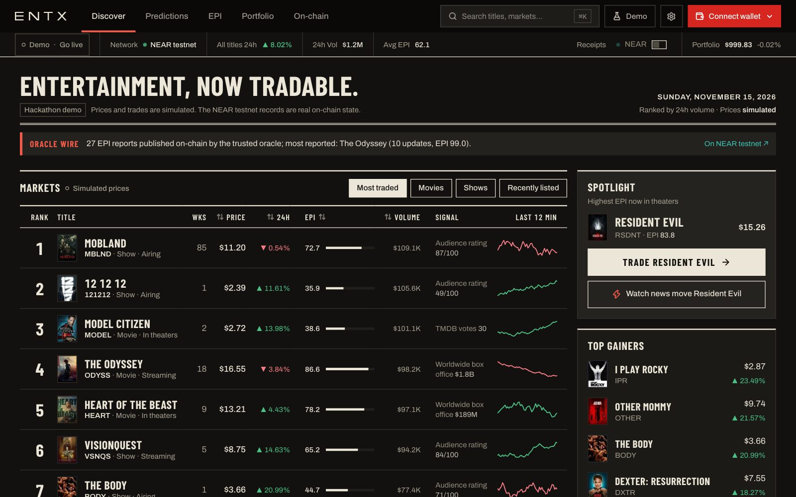</a>

</div>

---

## Contents

- [What it is](#what-it-is)
- [Try it](#try-it)
- [Videos](#videos)
- [Screenshots](#screenshots)
- [Design](#design)
- [Quick start](#quick-start)
- [How it works](#how-it-works)
- [NEAR contract](#near-contract)
- [Security model](#security-model)
- [Known limitations](#known-limitations)
- [Project structure](#project-structure)
- [Deployment](#deployment)
- [Environment](#environment)
- [Roadmap](#roadmap)
- [Hackathon](#hackathon)

## What it is

ENTX turns movies and shows into tradable markets. Each title gets a 0–100 **EPI** built from box office,
popularity, audience activity and ratings. When the EPI moves, simulated traders reprice the market and linked
YES/NO prediction markets shift.

- **NEAR** holds the market registry, a trusted EPI oracle, trade receipts and real-NEAR parimutuel prediction pools.
- **NEAR Intents** quotes show how a user could fund from SOL, ETH or USDC on any chain.
- **Solana** devnet stores a second, linked memo receipt for each trade.
- **ENTX Analyst** gives a rule-based signal with every factor and weight visible. It recommends, never trades.

> [!IMPORTANT]
> **What is real and what is simulated.**
> Titles, posters, release info and EPI inputs are **real**, seeded from TMDB. Spot prices, AMM trades, balances
> and oracle *events* are **simulated** off-chain, and the UI labels them that way.
> **Real on-chain:** the NEAR contract and its state, oracle EPI reports, trade receipts, YES/NO staking with
> testnet NEAR plus settlement and claims, and the Solana memo receipts.
> Trade receipts are self-attested notarisations: the contract stores what the wallet signs and does not verify
> the trade. Linked NEAR + Solana receipts are **not** an atomic cross-chain settlement. NEAR Intents quotes are
> live mainnet prices requested with `dry: true`, so no deposit address is created and no funds move.

## Try it

| Site | Mode | What you get |
| --- | --- | --- |
| **[demo.entx.space](https://demo.entx.space)** | Demo · NEAR testnet | Fully simulated market with demo controls: push news, watch EPI then price react, settle markets early. **Start here.** |
| **[entx.space](https://entx.space)** | Live · NEAR testnet | Real TMDB data and real on-chain NEAR prediction pools. No demo controls. Asset trading is labelled *preview*. |
| **[solana.entx.space](https://solana.entx.space)** | Demo · Solana devnet | Same app on Solana, with a devnet memo receipt per trade. |

Each site opens on a landing page at `/`; **Open the markets** goes to the app at `/markets`.
The **Demo / Live** badge in the top bar, and **Settings → Environment**, switch between the sites.
On-chain actions (staking, receipts) need a NEAR testnet wallet (Meteor, Intear, MyNearWallet) and testnet NEAR from
the [faucet](https://near-faucet.io).

<details>
<summary><b>Five-minute walkthrough on the demo site</b></summary>

1. **Connect a wallet.** On NEAR sites, *Connect wallet* opens near-connect. On the Solana site it connects Phantom,
   Solflare or Backpack on devnet. Each site shows only its own chain.
2. **Discover** (`/markets`) → open the **Spotlight** title (the highest-EPI film in theaters, e.g. *Resident Evil*).
3. **Buy 10 units.** The AMM fills the simulated trade, then the wallet signs a NEAR `record_trade` receipt (or a
   Solana devnet memo on the Solana site).
4. **Demo → "Box office beats forecast".** The EPI recalculates (e.g. 83.8 → 90.7). The oracle service publishes
   the title's baseline EPI plus that event's weighted impact (clamped to ±15 of baseline) and signs `report_epi`
   with a key that can call nothing else. A toast links the transaction on NearBlocks. Simulated traders reprice
   the market and the linked prediction odds move.
5. **ENTX Analyst** shows the signal and every factor behind it.
6. **Prediction market → On-chain pool.** Stake **0.1 testnet NEAR on YES**. After `near:resolve`, press
   **Claim** for a pro-rata payout.
7. **On-chain** (`/onchain`) shows live contract stats, oracle EPI vs app EPI, pools, receipts and the
   **NEAR Intents** quote panel.
8. **Portfolio** shows P&L, holdings, open predictions, trade history with receipt links, and the leaderboard.

</details>

## Videos

<table>
  <tr>
    <td width="50%"><a href="docs/assets/video/entx-launch.mp4">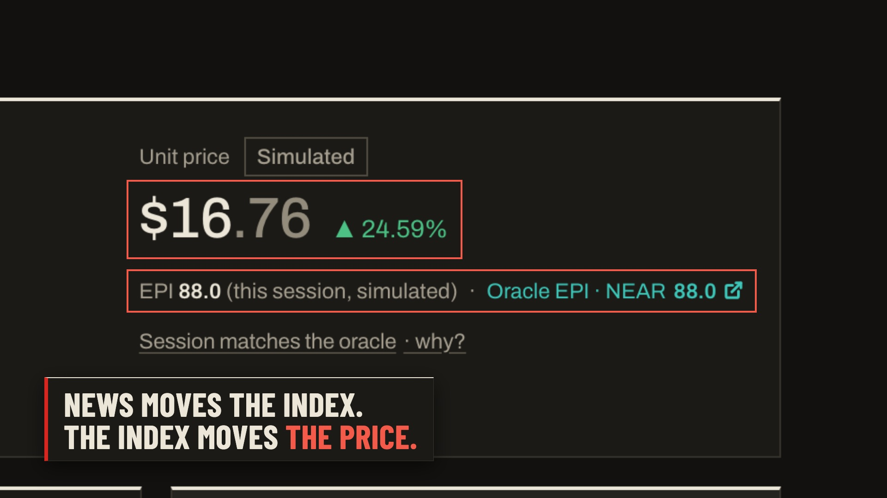</a><br><sub><b>Launch video</b> (20 s): a box-office beat moves the EPI, the price and the prediction odds; a real wallet signs; the contract shows it all</sub></td>
    <td width="50%"><a href="docs/assets/video/testnet-walkthrough.mp4">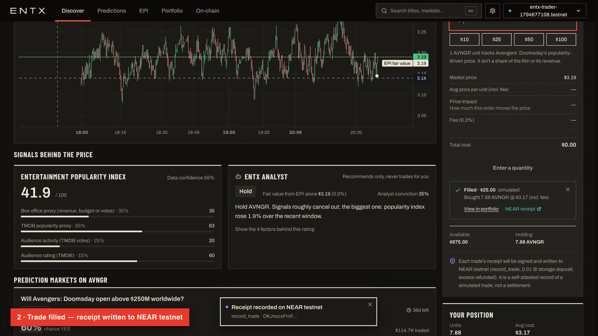</a><br><sub><b>Testnet walkthrough</b> (3:25, no audio): connect Meteor → buy → sign <code>record_trade</code> → stake 0.1 Ⓝ → on-chain page → resolve and claim</sub></td>
  </tr>
</table>

The walkthrough is a real run on NEAR testnet with a throwaway account (`entx-trader-1794677108.testnet`); every
step is a transaction you can look up. Resolve and claim run on a dedicated test market
(`walkthrough-settle-1794688742`) so the real markets stay open until their real outcomes:
[resolve](https://testnet.nearblocks.io/txns/CD3XJq397zotEZnEJ1YPcukSTg15ExY6zFcyBNx4RxZb) ·
[claim](https://testnet.nearblocks.io/txns/xqvUto58uvtifzHpzjYvY9sg8oM3srSqfD5iMZ6w8B4).

## Screenshots

Shown in the Night Edition (dark theme). Every screen also ships in the Day Edition; see [Design](#design).

<table>
  <tr>
    <td colspan="2">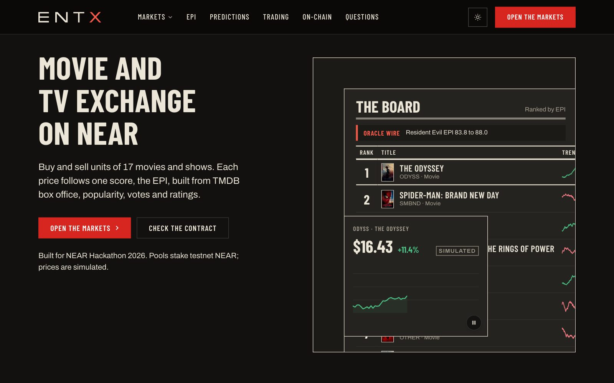<br><sub><b>Landing</b> (<code>/</code>): what ENTX is, the board in miniature, links for judges to verify on-chain</sub></td>
  </tr>
  <tr>
    <td width="50%">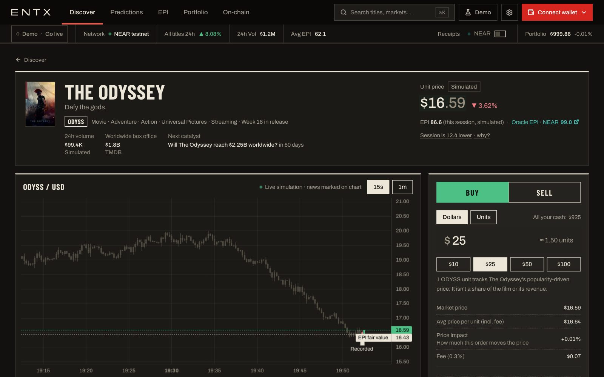<br><sub><b>Asset terminal</b>: live price, EPI fair value, AMM trade ticket</sub></td>
    <td width="50%">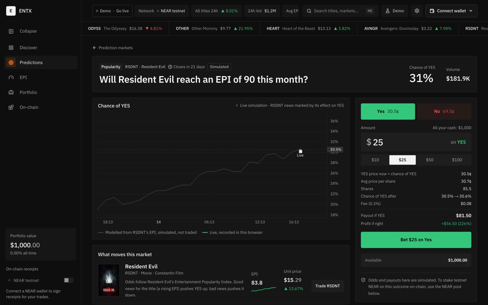<br><sub><b>Prediction market</b>: odds driven by the title's EPI</sub></td>
  </tr>
  <tr>
    <td>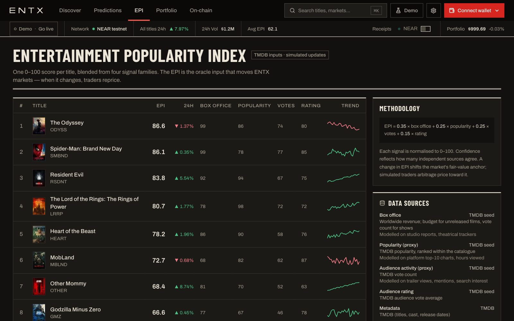<br><sub><b>EPI</b>: per-title score, inputs and methodology</sub></td>
    <td>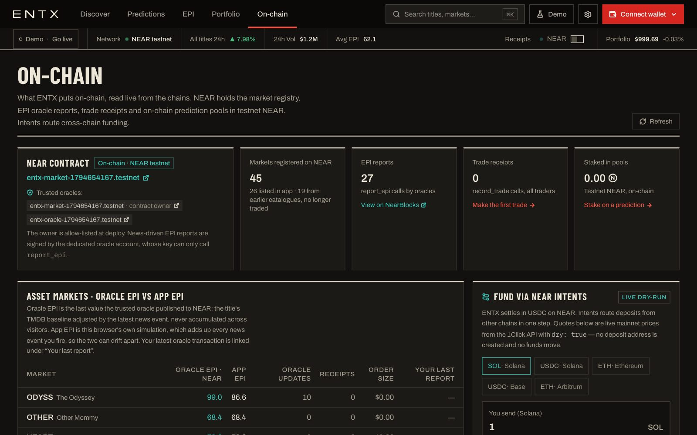<br><sub><b>On-chain</b>: contract state, oracle reports, NEAR Intents quotes</sub></td>
  </tr>
  <tr>
    <td>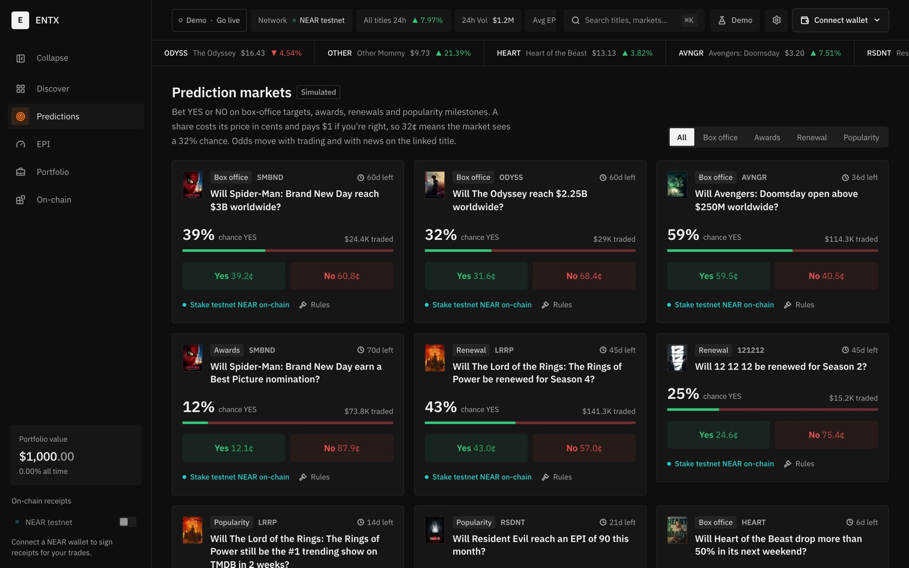<br><sub><b>Predictions</b>: markets generated from the catalogue</sub></td>
    <td>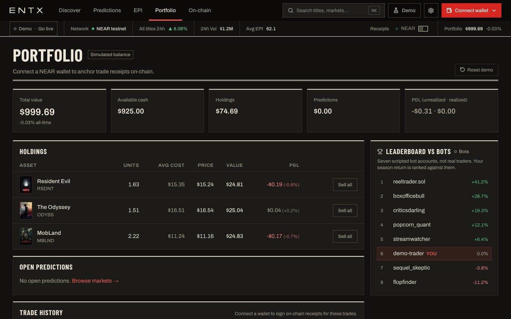<br><sub><b>Portfolio</b>: P&amp;L, holdings, receipts, leaderboard</sub></td>
  </tr>
</table>

<p align="center">
  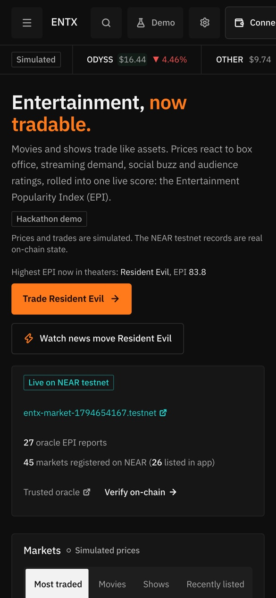
  &nbsp;&nbsp;
  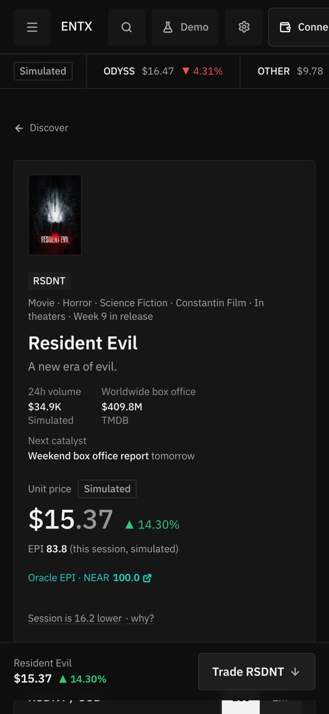
</p>

## Design

ENTX is set as a trade-press box office chart that never goes to press: ranked rows, big condensed rank numerals,
tabular figures, and the oracle as a red-ruled news wire above the board. Barlow Condensed names things (titles,
headings, the main action); Archivo with tabular figures states every number. Corners are square, panels are flat,
and structure comes from ink rules rather than shadows.

- **Day Edition:** ink on newsprint, with whiter panel stock and a white ticket where money is committed.
- **Night Edition:** the same chart under lamp light. Ink and paper swap: warm carbon ground, cream rules, panels
  stepping lighter toward the ticket, and red, gain and loss brightened to hold 4.5:1 contrast. No glow.
- **Choosing:** follows the OS by default. Switch in **Settings → Edition** (Day / Night / System) in the app, or with
  the sun/moon button on the landing page. The choice is saved per browser and applied before first paint.
- Colour is spent on meaning only: red for the brand and the wire, green and a separate red for gain and loss, teal and
  violet for NEAR and Solana.

The full system (tokens, type scale, components, rules) is in [`DESIGN.md`](DESIGN.md). App tokens live in
[`src/app/globals.css`](src/app/globals.css); the landing page's Night Edition in
[`public/site/landing-dark.css`](public/site/landing-dark.css).

## Quick start

Requires **Node ≥ 22** and **[Bun](https://bun.sh)**. No keys needed.

```bash
git clone https://github.com/harshonedev/entx.git && cd entx
bun install
bun run dev            # http://localhost:3000
```

The app reads the shared testnet contract with no configuration. Without an oracle key, EPI updates stay
off-chain; wallets, receipts, staking and Intents quotes still work.

| Command | What it does |
| --- | --- |
| `bun run dev` | Dev server on port 3000 |
| `bun run test` | Vitest suite (components, engine, store, API routes) |
| `bun run lint` | ESLint |
| `bun run build` | Production build (standalone output) |
| `bun run contract:test` | NEAR contract unit tests (`cargo test`) |
| `bun run near:deploy` | Deploy your own contract + oracle to testnet |
| `bun run seed:tmdb` | Refresh the catalogue from TMDB |

<details>
<summary><b>Deploy your own contract and trusted oracle (about 5 minutes)</b></summary>

Requires Rust with the `wasm32-unknown-unknown` target, [`cargo-near`](https://github.com/near/cargo-near) and
[`near-cli-rs`](https://github.com/near/near-cli-rs):

```bash
rustup target add wasm32-unknown-unknown
curl --proto '=https' --tlsv1.2 -LsSf https://github.com/near/cargo-near/releases/latest/download/cargo-near-installer.sh | sh
curl --proto '=https' --tlsv1.2 -LsSf https://github.com/near/near-cli-rs/releases/latest/download/near-cli-rs-installer.sh | sh

bun run contract:test   # registry, receipts, storage deposits/refunds, oracle trust, report ring,
                        # parimutuel payout, permissions, input sanitising
bun run near:deploy     # creates faucet-funded contract + oracle accounts, builds, deploys, registers all
                        # catalogue markets, allow-lists the oracle with a report_epi-only key, writes .env.local
bun run dev
```

Resolve a prediction market on-chain (owner/oracle only):

```bash
bun run near:resolve resident-evil-popularity-7 true
```

</details>

<details>
<summary><b>Refresh the catalogue from TMDB</b></summary>

The committed `src/data/catalog.json` was seeded from TMDB, so no key is needed to run the app.

```bash
echo 'TMDB_TOKEN=<v4 read access token>' >> .env.local   # or TMDB_API_KEY=<v3 key>
bun run seed:tmdb       # trending movies + upcoming tentpoles + trending shows → src/data/catalog.json
bun run near:register   # registers new markets on the contract (idempotent)
```

| EPI input (0–100) | Derived from (TMDB) |
| --- | --- |
| Box office proxy | movies: log-scaled worldwide revenue (budget if unreleased); shows: log-scaled vote count |
| TMDB popularity proxy | TMDB popularity, rank-normalised within the catalogue. **Not** streaming viewership. |
| Audience activity | log-scaled TMDB vote count. **Not** audience size. |
| Audience rating | vote average × 10 |

Prediction markets are generated from the catalogue: box-office milestones, opening weekends, awards, renewals,
trending rank, an EPI target and a weekend-drop market.

</details>

<details>
<summary><b>Inspect the live contract from a terminal</b></summary>

Needs [near-cli-rs](https://near.cli.rs):

```bash
near contract call-function as-read-only entx-market-1794654167.testnet get_stats json-args '{}' network-config testnet now
near contract call-function as-read-only entx-market-1794654167.testnet get_epi_reports json-args '{"market_id":"resident-evil"}' network-config testnet now
near contract call-function as-read-only entx-market-1794654167.testnet get_oracles json-args '{}' network-config testnet now
near contract call-function as-read-only entx-market-1794654167.testnet get_recent_receipts json-args '{"limit":10}' network-config testnet now
```

</details>

## How it works

```
            ┌──────────────────────── Next.js 16 app ─────────────────────────┐
            │ Discover · Terminal · Predictions · EPI · Portfolio · On-chain   │
            │                                                                  │
            │  Market engine (client, simulated)                               │
            │   ├─ constant-product AMM per title (0.3% fee, live candles)     │
            │   ├─ EPI = .35 box office + .25 popularity + .25 votes + .15 rating
            │   ├─ oracle event → ΔEPI × 2.6 = target move → bot traders       │
            │   └─ CPMM YES/NO markets linked to titles                        │
            │  ENTX Analyst (rule-based, explainable, advisory only)           │
            └───────┬───────────────────────┬───────────────────────┬──────────┘
                    │ near-connect          │ /api/oracle            │ /api/intents/quote
                    ▼                       ▼ (server signer)        ▼
   ┌──────────── NEAR testnet: entx contract ─────────┐      NEAR Intents 1Click
   │ register_markets   report_epi (trusted/untrusted) │      (mainnet, dry: true)
   │ record_trade (+ chain_ref)   stake / resolve / claim
   │ views: get_stats get_markets get_recent_receipts …│
   └───────────────────────────────────────────────────┘
                    ▲ chain_ref = "solana:devnet:<sig>"
   Solana devnet ── SPL Memo receipt (wallet-adapter) ──┘
```

| Component | Where |
| --- | --- |
| NEAR contract (testnet) | [`entx-market-1794654167.testnet`](https://testnet.nearblocks.io/address/entx-market-1794654167.testnet) |
| Trusted oracle (testnet) | [`entx-oracle-1794654167.testnet`](https://testnet.nearblocks.io/address/entx-oracle-1794654167.testnet), function-call key limited to `report_epi` |
| Contract source | [`contracts/near/src/lib.rs`](contracts/near/src/lib.rs) (Rust, near-sdk 5.30) |
| Solana receipts | SPL Memo program `MemoSq4gqABAXKb96qnH8TysNcWxMyWCqXgDLGmfcHr` on devnet |
| NEAR Intents | 1Click API `https://1click.chaindefuser.com/v0/quote` (dry run) |

## NEAR contract

| Method | Who | What |
| --- | --- | --- |
| `new(owner_id)` | deployer | init; owner is the first trusted oracle |
| `register_markets(markets)` | owner | asset + prediction registry (id, kind, title, ticker, EPI) |
| `add_oracle(account_id)` | owner | allow-list another EPI reporter |
| `report_epi(market_id, epi_x10, note)` *payable* | anyone | oracles move canonical EPI; others file untrusted reports and pay storage |
| `record_trade(market_id, side, qty_micro, price_micro, chain_ref?)` *payable* | any trader | notarised receipt; caller pays storage (~0.003–0.008 Ⓝ), excess refunded |
| `stake(market_id, outcome)` *payable* | any trader | parimutuel YES/NO pool, min 0.01 NEAR |
| `resolve(market_id, outcome)` | oracle | settle a prediction market |
| `claim(market_id)` | stakers | payout = stake × total / winning pool (U256 math; refunds if nobody won) |

Every state change emits an NEP-297 `EVENT_JSON` log (`standard: "entx"`).

## Security model

- **Caller-paid storage.** `record_trade` and untrusted `report_epi` measure the storage they add and require a
  deposit to cover it, refunding any excess. Spam costs the spammer, not the contract.
- **Bounded reads.** Receipts and EPI reports are indexed per account and per market. Every view is paginated
  (`limit` ≤ 50, `before` cursor), so no view scans global history.
- **Bounded contract-paid storage.** Trusted EPI reports live in a fixed 32-slot ring per market, so oracle activity
  can never lock up staked NEAR. Untrusted reports are indexed separately and can't evict trusted history.
- **Least-privilege oracle.** The server signs with a separate account's function-call key, limited to `report_epi`
  with a 1 NEAR gas allowance. It cannot `resolve`, touch stakes or move funds (verified on testnet:
  `Access key does not allow method resolve`).
- **Clients can't choose oracle values.** `/api/oracle` accepts only `{assetId, eventId}` from a fixed event
  catalogue. The server derives the new EPI from the current on-chain value.
- **Oracle access.** Publishing requires `Authorization: Bearer $ORACLE_API_SECRET` by default.
  `ENTX_PUBLIC_ORACLE=true` (demo site only) lets in-app buttons publish, bounded by global limits (1 per 1.5 s,
  240 per hour). Authenticated publishers get a separate rate-limit bucket. Client IPs are trusted only behind a
  known proxy (`VERCEL`, `TRUST_PROXY=true` or `TRUST_PROXY=cloudflare`) and must parse as an IP.
- **Hardened public routes.** JSON bodies capped at 2 KB, own-key catalogue lookups, rate-limited Intents proxy with
  an 8 s upstream timeout. Every response sends `X-Frame-Options: DENY`, HSTS, `nosniff` and a strict referrer policy.
- **Live is locked down.** The live site sets `ENTX_PUBLIC_ORACLE=false`.

## Known limitations

This is a testnet prototype.

- **Two EPIs, by design.** *App EPI* is this browser's simulation and accumulates every event you fire.
  *Oracle EPI* is what the trusted oracle published to NEAR. `/onchain` shows both.
- **EPI inputs are TMDB proxies**, not streaming viewership or audience size.
- **Self-attested receipts.** `record_trade` proves a wallet signed a record, not that the trade happened.
  Per-market `trades`/`volume` counters are not trustworthy metrics.
- **Shared contract.** Demo and live use one contract, so demo-site news reaches live's on-chain EPI history (fix
  planned in M1). Oracle events are still demo buttons, with a single trusted reporter.
- **Public oracle mode is testnet-only by convention.** Its rate limits are in-memory per process.
- **Claims.** `claim` marks the stake claimed, then sends a plain transfer with no callback. Any allow-listed oracle
  can `resolve`. No `remove_oracle` yet.
- **No real money.** Testnet NEAR and Solana devnet only. Intents quotes are never executed.

## Project structure

```
entx/
├── contracts/near/          NEAR contract (Rust) + unit tests
├── DESIGN.md                design system (Day and Night editions)
├── docs/                    deploy guide, demo script, README assets
├── scripts/                 testnet deploy/register/resolve, TMDB seeder
├── src/
│   ├── app/                 Next.js App Router pages + API routes
│   │   ├── (site)/              landing page at /
│   │   ├── (app)/               the trading app: /markets, /asset, /predictions, /epi, /portfolio, /onchain
│   │   ├── api/oracle/          oracle service (server-derived EPI, FC-key signer)
│   │   └── api/intents/quote/   NEAR Intents 1Click dry-run proxy
│   ├── components/          UI (trade panel, charts, order book, wallets…)
│   ├── data/catalog.json    real TMDB catalogue + generated prediction markets
│   ├── lib/                 engine (AMM/CPMM), EPI, NEAR + Solana clients, analyst
│   └── store/market.ts      simulation tick, trades, oracle publish, settlement
├── test/                    Vitest setup
└── Dockerfile               standalone Next.js image, non-root
```

| File | Role |
| --- | --- |
| [`src/lib/engine.ts`](src/lib/engine.ts) | AMM, CPMM, candle generation |
| [`src/lib/epi.ts`](src/lib/epi.ts) | EPI formula, shared by app and seeder |
| [`src/store/market.ts`](src/store/market.ts) | simulation, trades, oracle publish, settlement |
| [`src/lib/near.tsx`](src/lib/near.tsx) | near-connect provider, `record_trade` receipts |
| [`src/lib/solana.ts`](src/lib/solana.ts) | Solana memo receipts, devnet airdrop |
| [`src/lib/receipts.ts`](src/lib/receipts.ts) | Solana → NEAR linked receipt flow |
| [`src/lib/analyst.ts`](src/lib/analyst.ts) | explainable signal engine |
| [`scripts/near-deploy.sh`](scripts/near-deploy.sh) | one-command testnet deploy |

## Deployment

One `Dockerfile` (Next.js standalone output, about 85 MB, non-root) deployed three times on Coolify with different
build variables. Full steps, per-site env and DNS: [`docs/deploy-coolify.md`](docs/deploy-coolify.md).

```bash
docker build --build-arg NEXT_PUBLIC_ENTX_MODE=live -t entx:live .
docker run --rm -p 3000:3000 entx:live
```

## Environment

All variables are optional. See [`.env.example`](.env.example).

| Variable | Purpose |
| --- | --- |
| `NEXT_PUBLIC_ENTX_MODE` | `demo` (default, fully simulated) or `live` (no demo controls). Build time |
| `NEXT_PUBLIC_CHAIN` | `near` (default) or `solana`: the chain this deployment shows. Build time |
| `NEXT_PUBLIC_FLAG_CHAIN_SWITCH` | `true` shows the chain switch in Settings |
| `NEXT_PUBLIC_URL_NEAR_LIVE` / `_NEAR_DEMO` / `_SOLANA` | where the mode badge and Settings link to |
| `ENTX_PUBLIC_ORACLE` | `true` lets in-app buttons publish oracle reports (demo only) |
| `ORACLE_API_SECRET` | bearer secret for server-side oracle publishers |
| `TRUST_PROXY` | `true` behind Traefik, `cloudflare` behind Cloudflare |
| `NEXT_PUBLIC_NEAR_CONTRACT` | contract to use (defaults to the shared testnet deployment) |
| `NEAR_ORACLE_ACCOUNT` / `NEAR_ORACLE_PRIVATE_KEY` | server-only oracle signer (function-call key, `report_epi` only) |
| `NEXT_PUBLIC_SOLANA_RPC`, `NEXT_PUBLIC_NEAR_RPC` | RPC overrides |
| `ONECLICK_JWT` | 1Click API key (lower fee tier; quotes work without it) |

## Roadmap

Tracked milestone by milestone in [`MILESTONE.md`](MILESTONE.md). Each milestone ends with tests and a security audit.

- [ ] On-chain AMM pools on NEAR, collateralised in USDC, with Intents deposits executed for real
- [ ] Multi-source oracle quorum (box office, streaming charts, social APIs) with signed attestations
- [ ] Analyst as an agent under a limited function-call key and user-set risk limits
- [ ] Scheduled TMDB re-seeding feeding the oracle, so EPI moves with real metric changes

## Hackathon

Built for **NEAR Hackathon 2026**, tracks **Unstoppable DeFi** and **Open Innovation**. Everything in this
repository was built during the event: the web app, market engine, NEAR contract, oracle service, Intents
integration and Solana receipts.

## Attribution

This product uses the TMDB API but is not endorsed or certified by TMDB. Title metadata and posters © their
respective owners via [TMDB](https://www.themoviedb.org).

## License

[MIT](LICENSE)
